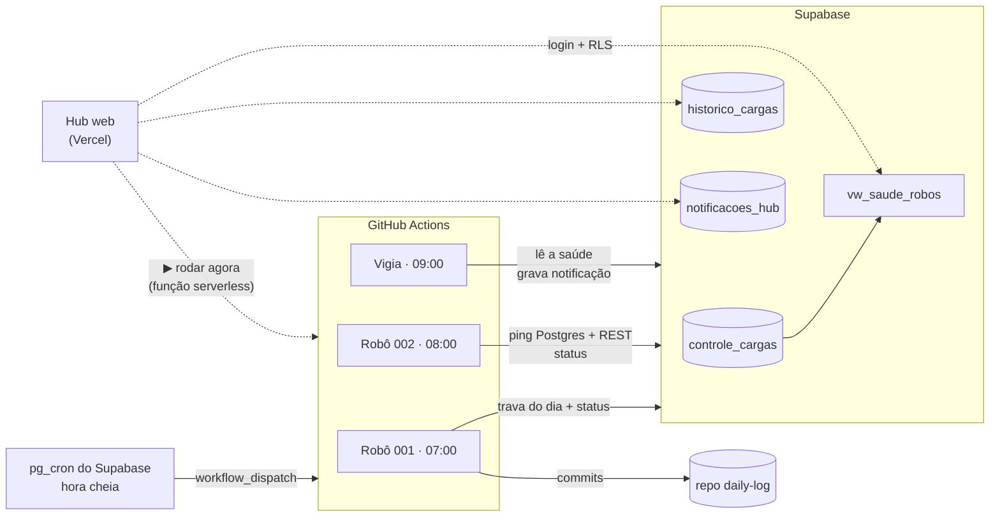

# ambiente_dev

[](https://github.com/diegoscs/ambiente_dev/actions/workflows/robo_001_check_github.yml)
[](https://github.com/diegoscs/ambiente_dev/actions/workflows/robo_002_check_supabase.yml)
[](https://github.com/diegoscs/ambiente_dev/actions/workflows/vigia_robos.yml)

Robôs de automação em Python que rodam sozinhos no **GitHub Actions**, registram
cada execução no **Supabase** e são acompanhados por um **hub web no celular**.

O projeto nasceu de um problema concreto: robôs agendados no Windows que paravam
quando o PC ficava desligado, sem avisar ninguém. A solução foi tirar o
agendamento da máquina, centralizar o controle num banco e medir não só se o
robô falhou, mas também se ele **deixou de rodar**.

## Destaques

- **Agendamento na nuvem**: um workflow por robô, com cron, disparo manual e
  log de erro anexado ao run.
- **Controle de cargas no Postgres (Supabase)**: última execução, histórico
  completo e uma view que classifica cada robô em `OK`, `ERRO`, `ATRASADO` ou
  `TRAVADO`.
- **Vigia diário**: transforma "o robô não rodou" em notificação no hub e em
  run vermelho no GitHub (que manda e-mail).
- **Hub web** na Vercel: login pelo Supabase Auth, leitura protegida por RLS e
  um botão que dispara o workflow sem expor token no navegador.
- **Biblioteca compartilhada** (`lib_dscs`): registro de status, retry nas
  etapas de rede, log só em caso de erro e alerta no Telegram. Os robôs não
  abrem conexão nem leem credencial por conta própria.
- **Schema versionado** em migrations e um [padrão documentado](automacoes/PADRAO_ROBOS.md)
  com [modelo](automacoes/_modelo) para criar robôs novos.

## Robôs

| Robô | O que faz | Quando roda (São Paulo) |
|---|---|---|
| [**004 · Clima Praias**](automacoes/004_clima_praias/README.md) | ranking das praias de Ubatuba por chance de sol (Open-Meteo), de amanhã até a próxima terça, com gráficos hora a hora e mapa de chuva no [app público](https://praias-ubatuba.vercel.app) | 05:00 |
| [**003 · Sync Open Finance**](.github/workflows/robo_003_sync_openfinance.yml) | sync do [financas-app](https://github.com/diegoscs/financas-app) (Pluggy → Supabase OpenFinance), registrado no hub | 06:00 e 15:00 |
| [**001 · Check GitHub**](automacoes/001_check_github/README.md) | registro diário num repositório próprio pela Contents API, com trava de uma execução por dia | 07:00 |
| [**002 · Check Supabase**](automacoes/002_check_supabase/README.md) | keepalive do projeto Supabase: consulta real por Postgres e por REST, para o plano free não pausar | 08:00 |
| [**Vigia**](automacoes/vigia_robos.py) | lê a saúde de todos os robôs, deixa uma notificação no hub e falha o run se algum estiver atrasado ou com erro | 09:00 (+ reserva à tarde) |
| [**Minecraft na nuvem**](apps/minecraft/gcp/README.md) | servidor da galera numa VM do Google: status, chat, custo e backups no [hub do servidor](https://server-galera.vercel.app); desliga sozinho após 5 min vazio (não é carga) | a cada minuto, dentro da VM |

Os horários são em **hora cheia**, disparados pelo `pg_cron` do Supabase, que
chama o `workflow_dispatch` de cada robô
([migration](supabase/migrations/20261027233340_robos_disparo_pg_cron.sql)). O
`schedule` do GitHub atrasava as execuções de 2 a 7 horas. Ele ficou só no
vigia, como reserva independente: se o vigia das 09:00 não passou, o disparo
falhou, e a reserva avisa.

## Arquitetura



Cada execução marca `RUNNING` ao começar e fecha como `SUCCESS` ou `ERROR`,
com uma mensagem legível, a quantidade de trabalho feito e o link do run no
Actions. Na falha, o log completo sobe como artifact do run e sai um alerta no
Telegram.

## Hub

Painel pensado para o celular, instalável na tela inicial:

- status de cada robô e há quanto tempo foi a última execução
- calendário dos últimos 14 dias por robô
- últimas execuções e notificações do vigia
- botão **▶ Rodar agora**, que dispara o workflow do robô

A página tem só a chave pública do Supabase. Os dados ficam atrás de RLS com
uma policy que libera leitura apenas para o usuário cadastrado. O token do
GitHub usado pelo botão fica numa função serverless da Vercel, que confere o
login no Supabase antes de disparar. Um robô novo cadastrado no banco aparece no
hub sem mudar o código dele. Detalhes em [apps/hub/README.md](apps/hub/README.md).

## Decisões de projeto

- **Robô que não roda é silencioso.** Numa semana de setembro de 2026 um robô
  ficou sem rodar e o projeto do Supabase chegou a ser pausado, sem nenhum erro
  registrado: o último status continuava `SUCCESS`. Por isso a
  [`vw_saude_robos`](supabase/migrations/20260926124646_controle_cargas_workflow.sql)
  mede **atraso** (`dta_fim` mais antiga que `atraso_max_horas`), e o vigia
  transforma isso em aviso.
- **Trava diária no banco, não em arquivo.** A máquina do Actions começa vazia
  a cada execução, então um arquivo de estado local não lembra de nada. A trava
  soma o trabalho do dia no `historico_cargas`, inclusive lotes que quebraram
  no meio, para nunca repetir um dia já feito.
- **"Dia" é UTC.** O calendário de contribuições do GitHub conta pelo horário
  UTC do commit. Com a trava em hora local, uma execução às 22h de São Paulo
  caiu no dia seguinte e deixou um dia em branco com `SUCCESS` gravado.
- **Registro nunca derruba o robô.** Se gravar o status falhar, isso vira log;
  o erro original do robô continua sendo o que aparece.
- **Privilégio mínimo.** A chave de serviço só existe nos secrets do Actions. No
  banco, RLS ligada e escrita revogada para os papéis públicos (o Supabase
  concede escrita por padrão, e um grant de coluna não restringe nada enquanto
  o de tabela existir). O hub lê, e nas notificações só pode marcar como lida.

A migração do Agendador do Windows para a nuvem, com o antes e depois, o
checklist e a revisão de segurança, está em [docs/migracao_nuvem.md](docs/migracao_nuvem.md).

## Estrutura

```
.github/workflows/     um workflow por robô, mais o vigia
automacoes/
  001_check_github/    robô 001 e README
  002_check_supabase/  robô 002 e README
  004_clima_praias/    robô 004: src/ (coleta, score, relatório) e data/ (praias)
  _modelo/             esqueleto de robô, workflow e cadastro
  PADRAO_ROBOS.md      regras para robôs novos
  vigia_robos.py       vigia diário
apps/
  hub/                 hub web (HTML, função serverless, config da Vercel)
  minecraft/           servidor na nuvem: hub/ (Vercel), gcp/ (VM), monitor/
lib_dscs/              biblioteca compartilhada dos robôs
supabase/migrations/   schema versionado
docs/                  migração para a nuvem e revisão
```

`projetos/`, `clientes/` e `arquivo/` ficam fora deste repositório: cada
projeto ali tem o seu próprio repositório no GitHub.

## Stack

Python · GitHub Actions · Supabase (Postgres, PostgREST, Auth, RLS) ·
Vercel (site estático + função Node) · Telegram Bot API.
HTTP com `urllib` da biblioteca padrão e Postgres com `psycopg` 3.

## Rodando localmente

```bash
pip install -r requirements.txt
cp .env.example .env        # preencha as variáveis

python automacoes/002_check_supabase/002_check_supabase.py --dry-run
python automacoes/vigia_robos.py
```

`--dry-run` executa sem gravar status nem alterar nada no destino. Execução
real registra o `MODO_EXECUCAO` na coluna `ambiente` (`LOCAL` no PC, `CLOUD`
no Actions).

## Criando um robô novo

1. Copie [`automacoes/_modelo/`](automacoes/_modelo) para `automacoes/NNN_nome/`.
2. Cadastre o robô em `controle_cargas` por migration (modelo em `cadastro_supabase.sql`).
3. Copie o workflow modelo para `.github/workflows/`.
4. Feche o checklist do [padrão](automacoes/PADRAO_ROBOS.md#10-pronto-é-quando).

Com o cadastro feito, o robô aparece sozinho no hub e no vigia.
