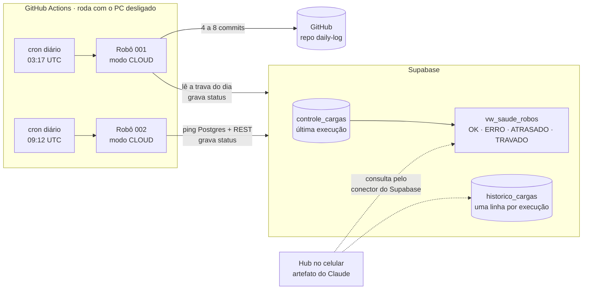
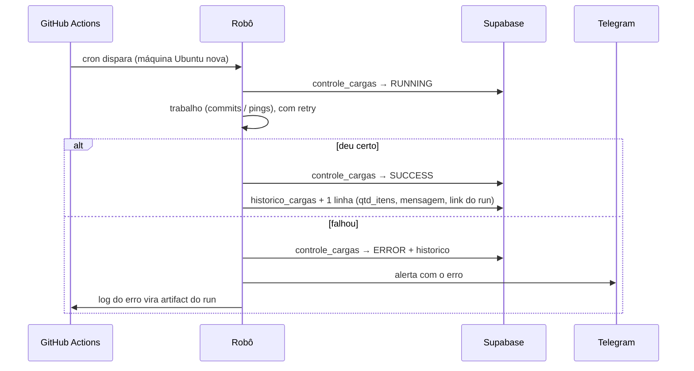

# ambiente_dev

Robôs de automação pessoais em Python, agendados no **GitHub Actions** e
monitorados pelo **Supabase**, com uma biblioteca compartilhada (`lib_dscs`)
no mesmo padrão que uso nas cargas do trabalho: controle de cargas, log só em
caso de erro, retry nas etapas de rede e alerta de falha no Telegram.

| Robô | O que faz | Quando roda |
|---|---|---|
| [**001 · Check GitHub**](automacoes/001_check_github/README.md) | commits diários num repositório próprio pela Contents API | todo dia, 03:17 UTC |
| [**002 · Check Supabase**](automacoes/002_check_supabase/README.md) | keepalive do projeto Supabase (plano free pausa com 7 dias sem uso) | todo dia, 09:12 UTC |

## Arquitetura



O Supabase é o **único registro oficial** do que os robôs fizeram. Antes da
migração ([detalhes](docs/migracao_nuvem.md)) os robôs rodavam no Agendador do
Windows, gravavam num Postgres local e copiavam a linha para o Supabase. Isso
deixava o 001 parado sempre que o PC ficava desligado, e a cópia precisava de
uma fila de pendências só para existir.

### Ciclo de uma execução



## Decisões que valem a leitura

- **Robô que não roda é silencioso.** Em setembro/2026 o 001 ficou 7 dias sem
  rodar e o projeto do Supabase chegou a ser pausado, sem nenhum erro em lugar
  nenhum: o último status continuava `SUCCESS`. Por isso a
  [`vw_saude_robos`](supabase/migrations/20260926121254_robos_nuvem_historico_e_saude.sql)
  mede **atraso** (`dta_fim` mais velha que `atraso_max_horas`), não só status.
- **Trava diária no banco, não em arquivo.** A máquina do Actions nasce vazia a
  cada execução, então o `estado.json` local não lembra de nada. A trava do 001
  soma os commits do dia UTC no `historico_cargas`. É o mesmo registro que o PC
  consulta, então PC e nuvem podem rodar em paralelo sem dobrar o dia.
- **O dia do 001 é o dia UTC.** O calendário de contribuições conta o commit
  pelo carimbo UTC. Com a trava em hora local, uma execução às 22:06 de São
  Paulo caiu no quadrado do dia seguinte e deixou um dia em branco com
  `SUCCESS` gravado.
- **Registro nunca derruba o robô.** Falha ao gravar status vira linha de log;
  o erro original do robô continua sendo o que aparece.
- **Log só em caso de erro.** Execução bem-sucedida não deixa arquivo; a falha
  grava o log inteiro com traceback, que no Actions sobe como artifact do run.
- **Segredos só no servidor.** A `service_role` do Supabase fica nos secrets do
  Actions; as tabelas têm RLS ligada e sem policy, então a chave pública não lê
  nada. O hub lê pelo conector do Supabase da minha conta no Claude, sem chave
  nenhuma na página.

## Estrutura

```
ambiente_dev\
├─ .github\workflows\         um workflow por robô (cron + disparo manual)
├─ automacoes\
│  ├─ 001_check_github\       robô 001 + README
│  ├─ 002_check_supabase\     robô 002 + README
│  └─ ...                     .bat e scripts do Agendador (modo LOCAL)
├─ hub\                       painel de celular (artefato do Claude) + README
├─ lib_dscs\                  biblioteca compartilhada dos robôs
├─ supabase\migrations\       schema do controle de cargas, versionado
└─ docs\                      migração para a nuvem, checklist e decisões
```

## Stack

Python 3.12 (Actions) / 3.14 (PC) · `urllib` da biblioteca padrão para HTTP ·
`psycopg` 3 · GitHub Actions · Supabase (Postgres + PostgREST) · Telegram Bot API.

## Rodando localmente

```powershell
# .env na raiz, a partir do .env.example
python automacoes\001_check_github\001_check_github.py --dry-run
python automacoes\002_check_supabase\002_check_supabase.py --dry-run

# simulando a nuvem no PC
$env:MODO_EXECUCAO = "CLOUD"; python automacoes\001_check_github\001_check_github.py --status
```

Os workflows também têm `workflow_dispatch`: dá para rodar qualquer robô pela
aba **Actions**, inclusive pelo celular.
