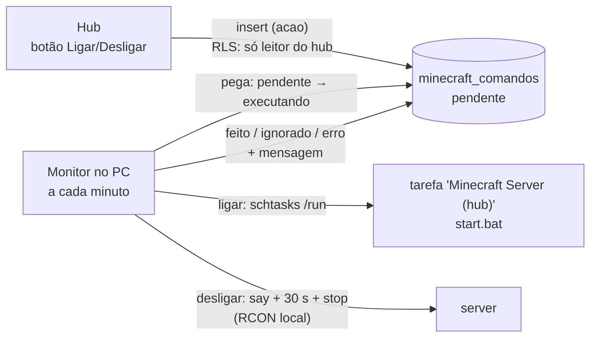

# Monitor Minecraft

Leva para o [hub](../../hub/README.md) o estado do server de Minecraft da galera
(`apps/minecraft/local`, fora do repositório): se está no ar, quem está
jogando, o chat e os comandos.

> **Desde 19/10/2026 o server roda numa VM do Google**, e quem chama este
> código a cada minuto é o [monitor da VM](../gcp/vm/monitor_vm.py)
> (ping, leitura do log e RCON). O que segue descreve a versão do PC, com o
> Agendador do Windows. Ela fica como referência, porque a lógica é a mesma.

## O que faz

A cada minuto (no PC, pelo Agendador do Windows; hoje, pelo timer da VM):

1. **Status**: pergunta ao server em `127.0.0.1:25565` pelo mesmo ping da lista
   de servidores do jogo (Server List Ping). Volta on/off, `online/max`, os nicks,
   a versão e a latência. Não usa RCON nem senha.
   Grava a linha única de `public.minecraft_status` (upsert no `id = 1`).
2. **Eventos**: lê o `logs/latest.log` do server (e os `.gz` girados desde o
   último evento gravado) e manda para `public.minecraft_eventos`:

   | tipo | linha do log |
   |---|---|
   | `chat` | `[Not Secure] <nick> texto`, `/me` e `/say` |
   | `comando` | `[nick: Set own game mode…]` (retorno de comando de op) e as linhas do script do KubeJS |
   | `entrou` / `saiu` | `nick joined the game` / `nick left the game` |
   | `conquista` | `nick has made the advancement [X]` |

   Mortes ficaram de fora: cada uma tem uma frase diferente e não dá para
   separar com segurança de outras mensagens do server.

3. **Ligar/desligar pelo hub**: executa os pedidos de `public.minecraft_comandos`
   (ver abaixo).

## Ligar e desligar pelo hub

O hub não alcança o PC, então o botão só **grava um pedido**; o monitor executa
na volta seguinte (até 1 min).



- **Ligar** roda a tarefa sob demanda `Minecraft Server (hub)` (criada pelo
  [`instalar_tarefa.ps1`](instalar_tarefa.ps1)), que abre o `start.bat` na
  janela de sempre. Ignora se o server já está no ar ou subindo (java com
  `win_args.txt`; o jogo aberto pelo TLauncher no mesmo PC não conta).
- **Desligar** manda `stop` pelo RCON local, com a senha lida do
  `server.properties`. Com gente jogando, avisa no chat e espera 30 s antes.
  O `stop` sai com código 0, e o `start.bat` não reinicia.
- **Pedido com mais de 10 min** sem o PC pegar vira `ignorado`: o server não
  liga horas depois, quando o PC voltar.
- **Um pedido aberto por vez** (índice único parcial). `executando` com mais
  de 5 min vira `erro` (o monitor caiu no meio), para não travar a fila.
- **Quem pode:** só quem está em `private.hub_leitores`, e só escolhe a
  `acao` (grant de insert só nessa coluna). Status, autor e horários vêm dos
  defaults; testado com usuário simulado: forjar `status`, alterar pedido,
  conta sem acesso e dois pedidos abertos são recusados.
- O PC desligado não liga pelo hub: sem o PC não há monitor para pegar o pedido.

A tarefa do server roda com **prioridade normal** e **sem limite de tempo**.
O padrão do Agendador é prioridade abaixo do normal e encerrar em 72 h. O
`setup-24x7.bat` da pasta do server cria a tarefa com `schtasks` e herda esses
dois padrões: revisar antes de rodá-lo.

## Por que roda no PC

O server só existe no PC, atrás da Radmin VPN. O GitHub Actions e a Vercel não
alcançam a porta 25565, e abrir a porta para a internet só para isso não vale o
risco. Então o PC **empurra** o estado para o Supabase, e o hub lê de lá.

Consequência: se o PC desliga, a linha para de ser atualizada. O hub compara
`dta_verificacao` com a hora atual e, passados 5 minutos sem sinal, mostra
**SEM SINAL** em vez de mentir "online".

## Comandos de qualquer jogador (KubeJS)

O Minecraft só registra no log os comandos de op que geram aviso para os admins.
`/msg`, `/tpa` e `/home` de jogador comum não aparecem. Para esses, o script
[`kubejs/monitor_comandos.js`](kubejs/monitor_comandos.js) escuta
`ServerEvents.command` e escreve cada comando no `logs/kubejs/server.log` com
o horário em UTC. O monitor lê essas linhas como `comando`.

- Fica em `server/kubejs/server_scripts/monitor_comandos.js`. A cópia nesta
  pasta é a versionada; mudou uma, copie para a outra.
- Carrega no start do server ou com `/reload`.
- Comando de console, RCON e bloco de comando fica de fora do script (mas o
  retorno de admin deles ainda aparece pelo `latest.log`, como `Rcon`).

## Decisões

- **Não é carga.** Não registra em `controle_cargas`/`historico_cargas`:
  1440 execuções por dia encheriam o histórico e o calendário dos robôs. A
  própria linha de status é o sinal de vida.
- **Horários carimbados pelo banco** (trigger `private.minecraft_status_carimbo`):
  `dta_verificacao` a cada gravação e `dta_mudanca` quando `online` muda. O
  relógio do PC não entra na conta do "sem sinal".
- **Eventos idempotentes.** A unique `(dta_evento, tipo, jogador, texto)` e o
  upsert com `ignore-duplicates` deixam o reenvio inofensivo. A posição de
  leitura é o evento mais recente no banco, não um arquivo local.
- **Primeira execução importa o histórico** que ainda estiver em `logs/`.
- **`pythonw`** para não piscar janela a cada minuto. Sem console, o log de
  erro vai para `temp/erro_000_monitor_minecraft_*.txt`, guardando só os 20
  mais recentes (sem internet o dia inteiro seriam 1440 arquivos).
- **Privacidade:** o chat dos amigos fica guardado no Supabase e visível no hub
  (só para quem está em `private.hub_leitores`). Vale avisar a galera.

## Configuração

| O quê | Onde |
|---|---|
| `SUPABASE_URL`, `SUPABASE_KEY` (service_role) | `.env` da raiz, os mesmos dos robôs |
| Tarefa "Monitor Minecraft (hub)" | [`instalar_tarefa.ps1`](instalar_tarefa.ps1): a cada minuto e no logon, também na bateria |
| Tabelas | [`20261019150000_minecraft_status_e_eventos.sql`](../../../supabase/migrations/20261019150000_minecraft_status_e_eventos.sql), [`20261019180000_minecraft_comandos.sql`](../../../supabase/migrations/20261019180000_minecraft_comandos.sql) |
| Tarefa "Minecraft Server (hub)" | também no `instalar_tarefa.ps1`: sob demanda, sem gatilho |

```powershell
$py = "C:\Users\ferna\AppData\Local\Python\bin\python.exe"
& $py apps\minecraft\monitor\monitor_minecraft.py --dry-run   # mostra, nao grava
& $py apps\minecraft\monitor\monitor_minecraft.py             # grava no Supabase
powershell -File apps\minecraft\monitor\instalar_tarefa.ps1   # (re)cria a tarefa
```

> **Servidor migrado para o Google Cloud em 19/10/2026, 19:00.** As tarefas do Agendador
> deste monitor foram desativadas e, em 27/10/2026, apagadas. O código segue em uso: o
> [monitor da VM](../gcp/vm/monitor_vm.py) importa este arquivo para o ping,
> a leitura do log e o RCON (`MINECRAFT_DIR` aponta a pasta). Ver
> [apps/minecraft/gcp](../gcp/README.md).

## Estado em 27/10/2026

- As 2 tarefas do Agendador (`Monitor Minecraft (hub)` e `Minecraft Server (hub)`)
  apagadas do PC. Para voltar a rodar o server no PC, o `instalar_tarefa.ps1`
  recria todas.
- Textos do card do server no hub falam da VM, não mais do PC.

## Estado em 19/10/2026

- Migration aplicada; 118 eventos importados dos logs desde 18/10.
- Tarefa do Agendador criada e rodando a cada minuto.
- Botões de ligar/desligar no hub. Testados com o server parado: "desligar"
  volta como ignorado e pedido velho é descartado. Ligar e desligar de verdade
  ainda não foram feitos pelo hub.
- Script do KubeJS carregado com `/reload` (0 erros). Ainda não visto com um
  jogador digitando comando: confira no hub, aba **Comandos**, na próxima vez
  que alguém jogar.
- "No ar desde" começou a contar na primeira gravação (14:38), não no start
  real do server (09:47). Corrige sozinho na próxima vez que o server reiniciar.
