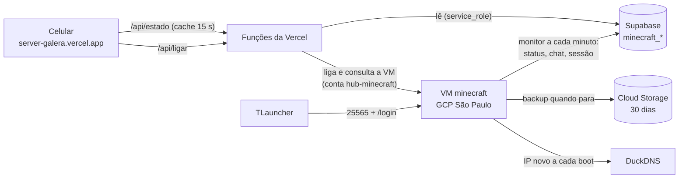

# Minecraft no Google Cloud

O servidor da galera (Create Chronicles: The Endventure, NeoForge 1.21.1) roda
numa VM do Google em São Paulo, liga pelo
[hub do servidor](../../hub_minecraft/README.md) e **desliga sozinho 5 minutos depois
que o último sai** (15 min de tolerância logo depois de ligar). Tutorial de uso (jogadores e admin):
[TUTORIAL.md](TUTORIAL.md).

## Peças

| Onde | Arquivo | O quê |
|---|---|---|
| VM | [`vm/minecraft.service`](vm/minecraft.service) | Servidor como serviço: sobe com a VM; ao parar manda `stop`, espera salvar e chama o backup |
| VM | [`vm/iniciar.sh`](vm/iniciar.sh) | O "start.bat" do Linux: sobe o servidor e reinicia se cair |
| VM | [`vm/monitor_vm.py`](vm/monitor_vm.py) | A cada minuto: sessão, DuckDNS, status/chat (reaproveita o [monitor_minecraft](../monitor_minecraft/monitor_minecraft.py)) e a trava de 15 min. `--backup`: mundo → Cloud Storage |
| VM | [`vm/extras_vm.py`](vm/extras_vm.py) | Extras do hub: TPS/tick (`neoforge tps`), CPU/RAM (`/proc`), hora/dia (`time query`), chuva (`level.dat`, leitor NBT próprio) e ranking (`world/stats` + `world/advancements`) |
| Banco | [`20261019230000_minecraft_extras.sql`](../../supabase/migrations/20261019230000_minecraft_extras.sql) | Tipo `morte`, colunas de desempenho/mundo, `minecraft_desempenho` (7 dias) e `minecraft_jogadores` |
| VM | [`vm/monitor-minecraft.timer`](vm/monitor-minecraft.timer) | Roda o monitor 30 s após o boot e depois a cada minuto |
| VM | [`vm/instalar_monitor.sh`](vm/instalar_monitor.sh) | Instala/atualiza monitor e serviços |
| PC | [`publicar_vm.ps1`](publicar_vm.ps1) | Empacota, envia e instala na VM (precisa dela ligada) |
| PC | [`baixar_backup.ps1`](baixar_backup.ps1) | Baixa o backup mais recente do Cloud Storage para `minecraft-server/backups_nuvem` e confere se abre. Cópia fora do Google: se a conta de faturamento tiver problema, os backups do balde vão junto |
| PC | [`console.bat`](console.bat) | Abre o console do servidor (tmux) pelo túnel do Google |
| Banco | [`20261019220000_minecraft_nuvem.sql`](../../supabase/migrations/20261019220000_minecraft_nuvem.sql) | `minecraft_sessoes`, `minecraft_backups` e colunas novas em `minecraft_status` |

## Recursos no Google (projeto `serverminecasaonly`)

| Recurso | Configuração |
|---|---|
| VM `minecraft` | `southamerica-east1-b`, **n2d-standard-4** (4 vCPU, 16 GB), Ubuntu 24.04, disco SSD 30 GB. Trava contra exclusão; o disco não é apagado junto com a VM |
| Firewall | `minecraft-jogo`: só TCP 25565. SSH (22) só pela faixa do IAP (`35.235.240.0/20`). RDP removido |
| Balde `serverminecasaonly-backups` | São Paulo, acesso público bloqueado, apaga objetos com mais de 30 dias |
| Conta `minecraft-vm` | Identidade da VM. Só `storage.objectCreator` no balde |
| Conta `hub-minecraft` + papel `minecraftHub` | Só `compute.instances.get` e `.start`, e só na VM `minecraft`. A chave fica na Vercel (`GCP_SA_KEY`) |
| Orçamento | Alerta por e-mail em R$ 550/mês, sem descontar os créditos |

## A trava de inatividade (5 min, ou 15 logo depois de ligar)

O monitor guarda a **última atividade** (último minuto com alguém online; no
boot, a hora do boot). O limite é **15 min até o primeiro jogador entrar**
(o TLauncher leva minutos para abrir o modpack) e **5 min depois que alguém
já jogou** naquele boot (`MINECRAFT_PRIMEIRA_MIN` / `MINECRAFT_IDLE_MIN`). O
limite em vigor vai para `minecraft_status.desliga_apos_min`, e o hub mostra a
contagem. Desliga quando:

- servidor online, **ninguém** jogando, e a última atividade passou do limite;
- servidor **fora do ar** (não subiu ou alguém deu `stop` no console), a VM
  ligada há 20 min ou mais e a última atividade passou do limite;
- alguém pediu para desligar pela fila `minecraft_comandos` (hub dos robôs).

**Jogador AFK** não segura a VM ligada: o
[`afk_kick.js`](../monitor_minecraft/kubejs/afk_kick.js) (KubeJS) kicka quem
fica **10 min sem mexer a câmera, falar ou mexer em blocos** (aviso no chat aos
8). Andar não conta, por causa de AFK em água corrente ou carrinho. Depois do
kick, se não sobrar ninguém, vale a trava de 5 min. Lista `EXCECOES` no topo
do script, para quem precisar deixar farm rodando. O hub mostra "💤 AFK X min"
ao lado do nick (`minecraft_status.afk`) e o kick no feed (tipo `afk`).

Desligar = status "desligando" → `systemctl stop minecraft` (salva e faz o
backup) → fecha a sessão com o motivo → status "desligada" → `shutdown`.

## Decisões

- **Linux e não Windows Server.** O teste grátis do Google não permite VM
  Windows, e a licença dobraria o custo por hora. O `console.bat` e o
  tutorial cobrem o que antes era a janela do `start.bat`.
- **Máquina normal (não Spot) durante os 3 meses de crédito.** Spot custa ~80%
  menos, mas o Google pode desligar no meio do jogo. Depois dos créditos:
  `gcloud compute instances set-machine-type` para e2-standard-2 e
  `set-scheduling --provisioning-model=SPOT`, com `-Xmx6G` no
  `user_jvm_args.txt` (hoje está `-Xms6G -Xmx10G`).
- **Mod de login (Login System 2.2) em vez de VPN.** O TLauncher não tem
  conta da Mojang (`online-mode=false`): sem senha, qualquer um entraria com o
  nick de um op. O mod é só de servidor (BCrypt), então ninguém instala nada.
  O painel web dele (porta 8080, senha padrão `admin123`) foi **desligado**.
- **Ligar não passa pela fila do banco.** Com a VM desligada não há monitor
  para pegar o pedido; a função da Vercel liga direto pela API do Google.
- **Backup na parada, não no start.** Com o servidor parado o mundo está
  consistente. Fica no Cloud Storage, fora da VM: se o disco morrer, o mundo
  não morre junto.
- **Custo estimado pelas sessões** (`minecraft_sessoes` × preço/hora + disco),
  porque o faturamento do Google atrasa horas. Preços em `hub_minecraft/api/estado.js`.
- **HTTP na mão no `monitor_vm.py`** só para o que a `lib_dscs` não cobre e só
  existe na VM: metadata do Google, upload binário no Cloud Storage e DuckDNS.
- **Não é carga:** não entra em `controle_cargas` (mesmo motivo do monitor do PC).

## Configuração

| Onde | Chave |
|---|---|
| VM `/opt/monitor/.env` (root, 600) | `SUPABASE_URL`, `SUPABASE_KEY`, `DUCKDNS_TOKEN` |
| `.env` do PC | `DUCKDNS_TOKEN` (o `publicar_vm.ps1` leva para a VM) |
| Vercel `server-galera` | `SUPABASE_URL`, `SUPABASE_SERVICE_KEY`, `GCP_SA_KEY` |

Atualizar o monitor depois de mexer no código:
`powershell -File automacoes\minecraft_gcp\publicar_vm.ps1` (com a VM ligada).

## Estado em 19/10/2026

- Migrado do PC para a VM às 19:00, com o mundo atual (o servidor de casa
  tinha parado às 18:17). Tarefas do PC desativadas no Agendador, não apagadas.
- Porta 25565 aberta; whitelist com os três nicks; cada jogador faz
  `/register` no primeiro acesso.
- Backup testado: 44 MB, 2 s, no Cloud Storage.
- **DuckDNS pendente:** falta `DUCKDNS_TOKEN` no `.env`. Até lá o hub mostra
  o IP, que muda a cada boot. Com o token: `publicar_vm.ps1`.
- Script do KubeJS `monitor_comandos.js` foi junto (comandos de todos os
  jogadores no feed).

## Mods além do modpack

| Mod | Onde | Por quê |
|---|---|---|
| Login System 2.2 | só servidor | Senha por jogador (TLauncher = offline-mode) |
| Tom's Simple Storage 1.21-2.4.2 (20/10/2026) | **servidor e cada jogador** | Pedido da galera: terminal de baús. Integra com o Sophisticated Storage do pack. Remover depois apaga os blocos dele do mundo |

## Incidente em 21/10/2026: servidor reiniciado no meio do jogo

- **O que houve:** às 21:40 o `unattended-upgrades` do Ubuntu instalou
  atualizações de segurança (entre elas a `liblzma5`) e o `needrestart`
  reiniciou o `minecraft.service` para usar a biblioteca nova. Os dois
  jogadores caíram; voltaram em ~1,5 min. Parada limpa: mundo salvo e backup
  feito (82,8 MB). Diagnóstico: o journal mostrou `Stopping minecraft.service`
  sem queda nem crash, logo depois do apt.
- **Correção:** [`vm/needrestart-minecraft.conf`](vm/needrestart-minecraft.conf)
  em `/etc/needrestart/conf.d/` proíbe reiniciar o servidor e o monitor
  sozinhos. As atualizações de segurança continuam; a biblioteca nova vale no
  próximo start (a VM desliga quando todos saem). Reboot automático do
  sistema segue desligado (`Automatic-Reboot "false"`).

## Incidente em 19/10/2026: senhas no hub público

- **O que houve:** entre ~19:20 e ~19:24, os `/register senha senha` de
  `digoscs` e `Marllonx12` apareceram no feed de comandos do hub público. O
  script do KubeJS registrava **todo** comando de jogador, e o monitor
  publicava.
- **Correção:** eventos apagados do Supabase; senhas mascaradas com `*` nos
  logs da VM (`latest.log`, `debug.log`, `kubejs/server.log`), mantendo o
  tamanho dos arquivos, que estavam abertos pelo servidor. Duas barreiras
  agora: o KubeJS não registra comandos de senha (`register`, `login`,
  `changepassword`, `loginadmin`...), e o monitor descarta esses comandos
  (`comando_publicavel` em `monitor_minecraft.py`). Mensagem privada
  (`/msg`, `/tell`, `/r`...) aparece só como "mensagem privada para Fulano".
- **Pendente:** quem se registrou nesse intervalo troca a senha
  (`/changepassword antiga nova`).
