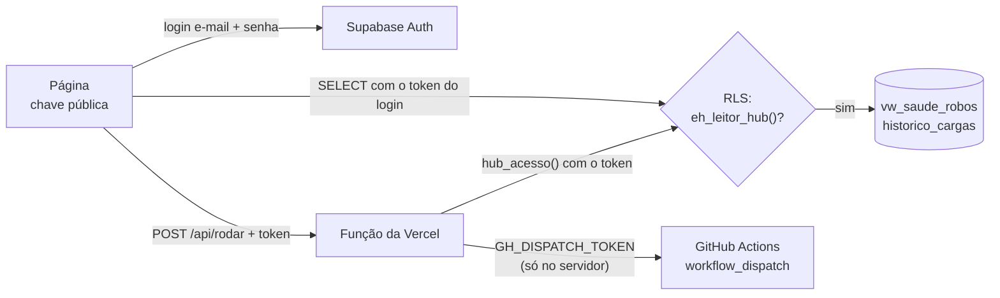

# Hub dos Robôs

Painel de celular com a saúde dos robôs, lido ao vivo do Supabase.

**https://hub-robos.vercel.app** · privado, com login

## O que mostra

- **Status por robô**, vindo da `vw_saude_robos`: `OK`, `ERRO`, `ATRASADO`,
  `TRAVADO`, `RODANDO` ou `NUNCA RODOU`. Uma faixa no topo resume tudo.
- **Calendário dos últimos 14 dias UTC** por robô: verde com execução `SUCCESS`,
  vermelho com `ERROR`. É o mesmo "dia" que o calendário de contribuições usa.
- **Últimas execuções**, de `historico_cargas`: onde rodou (PC ou nuvem),
  resumo e duração.
- **▶ Rodar agora**, que dispara o workflow do robô no GitHub Actions, e o link
  para o log do último run.

Atualiza sozinho a cada 2 minutos com a página visível, e na volta para a aba.
Instalável na tela inicial do celular (manifesto + ícone).

## Como a segurança funciona



- **A página só tem a chave pública** do Supabase, que foi feita para ficar no
  navegador. Sem login ela não lê nada: as tabelas têm RLS, e a policy
  `hub_leitura` só libera `SELECT` para quem está em `private.hub_leitores`.
- **Quem entra em `hub_leitores`:** o primeiro login no hub. A função
  `public.hub_acesso()` cadastra o usuário só se a tabela estiver vazia; depois
  disso, só por SQL. Contas novas no mesmo projeto recebem "sem acesso".
- **O token do GitHub nunca vai para a página.** Ele fica na variável
  `GH_DISPATCH_TOKEN` da Vercel. A função [`api/rodar.js`](api/rodar.js) confere
  o login no Supabase antes de disparar, e o nome do workflow sai de uma lista
  branca no servidor.
- **Escrita** nas tabelas continua só com a `service_role`, que só os robôs têm.

Migration: [`supabase/migrations/20260926123000_hub_leitura_autenticada.sql`](../supabase/migrations/20260926123000_hub_leitura_autenticada.sql).

## Configuração

| Onde | O quê |
|---|---|
| Vercel · Environment Variables | `GH_DISPATCH_TOKEN`: token **fine-grained** só do repo `ambiente_dev`, com *Actions: Read and write*. Sem ele, o botão responde "não configurado" e o resto funciona |
| Supabase · Auth | Login por e-mail e senha. Vale ligar a *Leaked password protection* |

## Deploy

Projeto `hub-robos` na Vercel (time `diegoscs-projects`), com esta pasta como
raiz. Hoje o deploy é pela CLI:

```powershell
cd D:\ambiente_dev\hub
vercel deploy --prod
```

Para deploy automático a cada push: na Vercel, **Settings → Git**, conectar
`diegoscs/ambiente_dev` e em **Settings → Build and Deployment** definir
*Root Directory* = `hub`.

## Arquivos

```
hub\
├─ index.html              a página (HTML + JS, sem build)
├─ api\rodar.js            função serverless do "Rodar agora"
├─ manifest.webmanifest    instalação na tela inicial
├─ icone.svg
├─ vercel.json             cabeçalhos de segurança
└─ artefato\               a primeira versão, como artefato do Claude (não publicada na Vercel)
```

A versão artefato ([`artefato/hub_robos.html`](artefato/hub_robos.html)) lê o
Supabase pelo conector do Claude da conta de quem abre. Continua funcionando em
https://claude.ai/artifact/Ef6brhUn8ntfNradu6shPa como reserva.
